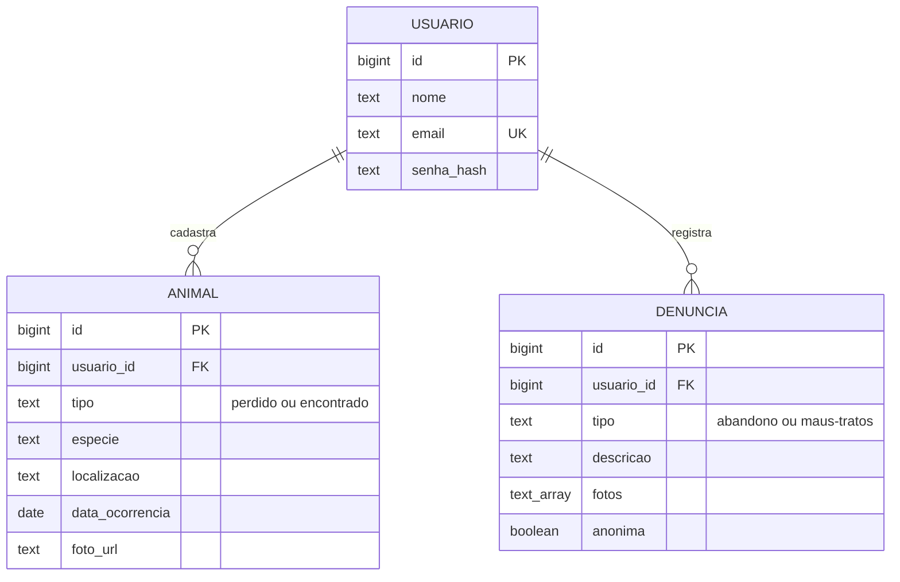
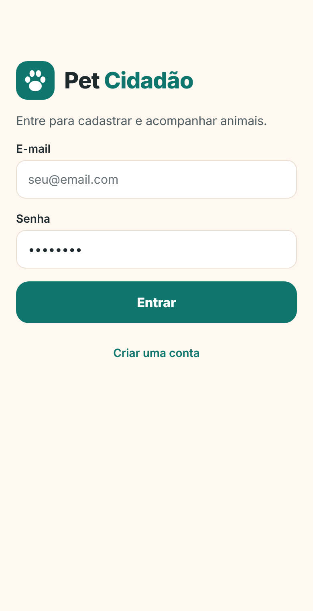
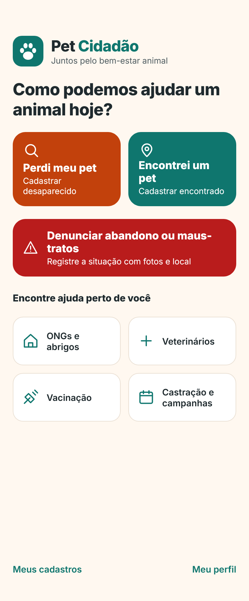
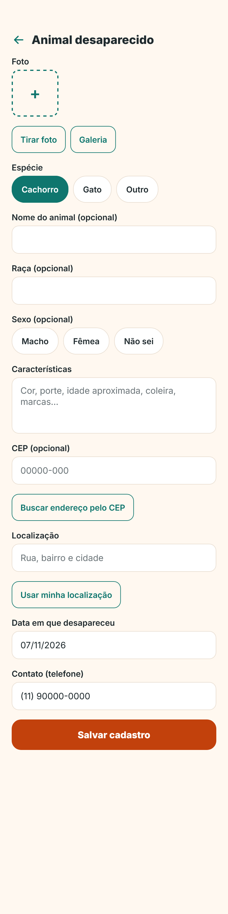
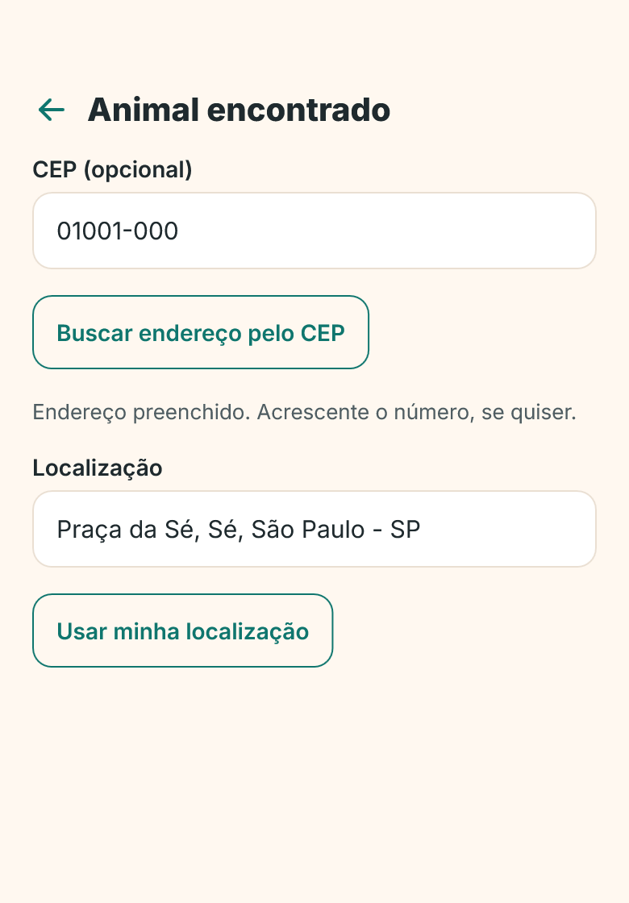
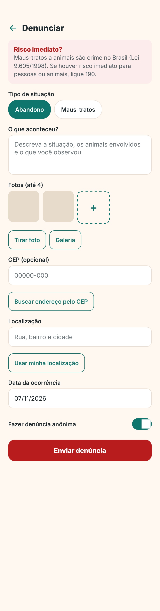
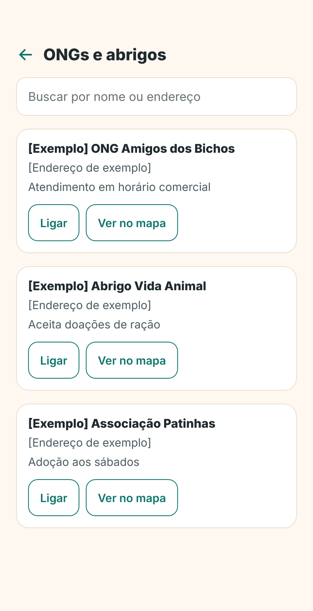
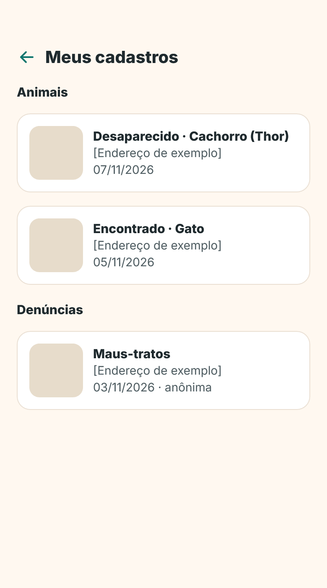
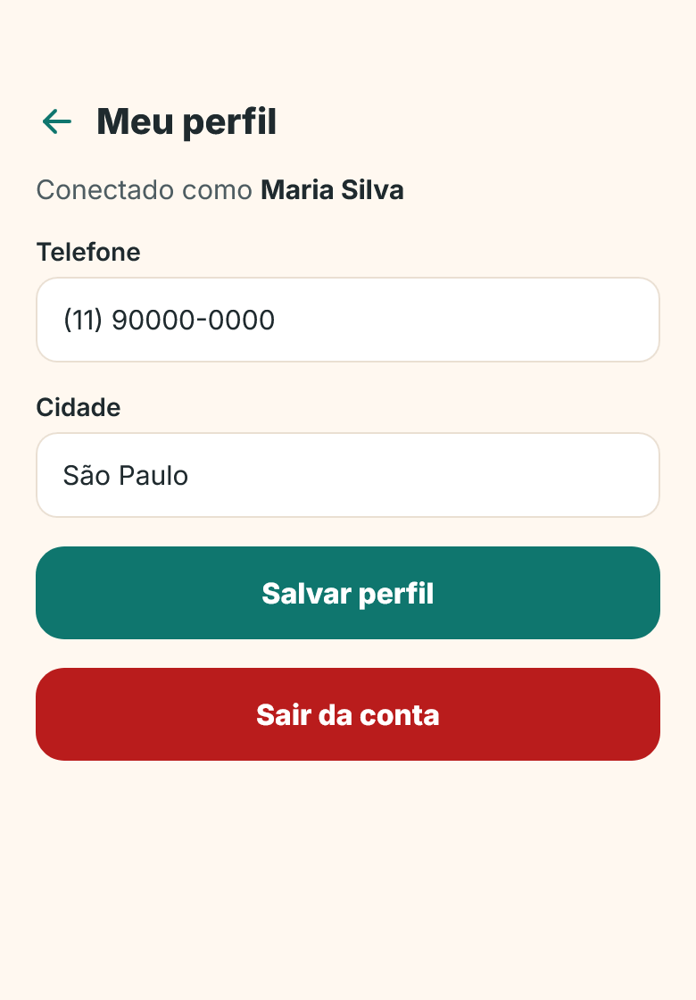
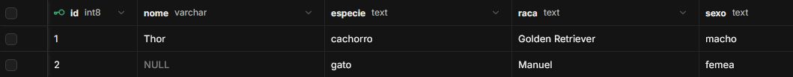

# Pet Cidadão

## Ficha CitizenTech

> **PREENCHER:** cole aqui a Ficha da CitizenTech fornecida pelo professor.

## Integrantes

| Nome | RM |
| --- | --- |
| Enzo Bonacasata Motta | 555372 |
| Eduardo da Silva Lima | 554804 |
| Estevam Melo | 555124 |
| Guilherme Ulacco | 558418 |
| Matheus Hostim | 556517 |

## Sobre o projeto

O **Pet Cidadão** é um aplicativo mobile para o bem-estar e a proteção de animais. Com ele, os cidadãos podem:

- cadastrar **animais desaparecidos** ou **encontrados**, com foto, características, localização e data;
- registrar situações de **abandono e maus-tratos**, com fotos e local da ocorrência;
- consultar **ONGs, abrigos, veterinários e campanhas** de vacinação e castração;
- acompanhar tudo o que cadastraram em **Meus cadastros**.

**Tecnologias:** Expo, React Native, Expo Router (navegação), TypeScript, Supabase (PostgreSQL + Storage) e a API pública ViaCEP.

## Como rodar o app

**Pré-requisitos:** [Node.js](https://nodejs.org) (versão LTS) e npm. Para testar no celular, o app **Expo Go**; para testar no navegador, nenhum requisito extra.

1. Clone o repositório e entre na pasta do projeto:

   ```bash
   git clone <URL-DO-REPOSITORIO>
   cd PetCidadao
   ```

2. Instale as dependências:

   ```bash
   npm install
   ```

   Se aparecer o erro `ERESOLVE` (conflito de versões do React), use `npm install --legacy-peer-deps`.

3. Crie o arquivo `.env` na raiz do projeto, copiando o modelo `.env.example`, e preencha com a URL e a chave do projeto Supabase:

   ```
   EXPO_PUBLIC_SUPABASE_URL=https://SEU-PROJETO.supabase.co
   EXPO_PUBLIC_SUPABASE_ANON_KEY=sua-chave
   ```

   > **PREENCHER:** explique como o avaliador obtém o `.env` (por exemplo, entregue junto com o trabalho) ou use o passo "Criar o próprio banco" abaixo.

4. Inicie o app:

   ```bash
   npx expo start
   ```

   - **Navegador:** pressione `w` no terminal.
   - **Celular:** abra o Expo Go e leia o QR Code (celular e computador na mesma rede).

   Se alterar o `.env`, reinicie com `npx expo start -c` para o Expo reler as variáveis.

### Criar o próprio banco (opcional)

1. Crie um projeto em [supabase.com](https://supabase.com).
2. Em **SQL Editor**, rode o arquivo [`supabase/schema.sql`](supabase/schema.sql). Ele cria as tabelas, as permissões, as funções de login e o bucket de fotos.
3. Copie a **Project URL** e a chave pública do projeto para o `.env`.

## Banco de dados

**Escolhido: Supabase (PostgreSQL gerenciado).**

Motivos da escolha:

- **Modelo relacional:** os dados têm relações claras (um usuário tem vários animais e várias denúncias), representadas por chaves estrangeiras e restrições (`check`, `unique`, `not null`).
- **PostgreSQL completo:** permite funções SQL, usadas no login com senha protegida por hash (bcrypt), e regras de segurança por tabela (RLS).
- **Storage integrado:** as fotos ficam no mesmo serviço, com link público permanente guardado no banco.
- **Sem servidor próprio:** o Supabase gera a API automaticamente e a biblioteca `supabase-js` conversa com ela direto do app Expo.
- **Gratuito para estudo** e com painel web, que facilita mostrar os dados salvos.

Modelo de dados:



## De onde vêm os dados

| Dado | Origem | Código |
| --- | --- | --- |
| Contas de usuário (cadastro e login) | Supabase, tabela `usuario`, pelas funções `cadastrar_usuario` e `login_usuario` | `lib/sessao.tsx` |
| Animais desaparecidos e encontrados | Supabase, tabela `animal` | `lib/animais.ts` |
| Denúncias | Supabase, tabela `denuncia` (leitura pela função `minhas_denuncias`) | `lib/denuncias.ts` |
| Fotos | Supabase Storage, bucket `fotos-animais` | `lib/animais.ts` |
| Endereço a partir do CEP | **API pública [ViaCEP](https://viacep.com.br)**, requisição com `fetch` | `lib/viacep.ts` |
| Lista de ONGs, veterinários e campanhas | **Dados de exemplo (mock)** fixos no código | `lib/locais.ts` |
| Telefone e cidade do perfil | Armazenamento local do aparelho (AsyncStorage) | `lib/storage.ts` |

### Estados de carregamento, erro e lista vazia

- **Busca de CEP** (formulários de animal e de denúncia): indicador "Buscando...", mensagem de erro sem conexão ou com a API fora do ar, e aviso de CEP não encontrado. Código em `lib/viacep.ts` e `components/ui.tsx`.
- **Meus cadastros:** tela de carregamento, erro com botão "Tentar de novo" e mensagem de lista vazia. Código em `lib/useCarregar.ts`, `components/Estado.tsx` e `app/meus-cadastros.tsx`.
- **Login e cadastro:** erros exibidos na própria tela (e-mail já cadastrado, senha incorreta, falha de rede).

## Estrutura do projeto

```
app/                    telas (Expo Router)
  _layout.tsx           navegação e proteção das rotas por login
  entrar.tsx            login e criação de conta
  index.tsx             Home
  animais/novo.tsx      cadastro de animal desaparecido ou encontrado
  denuncia/nova.tsx     denúncia de abandono e maus-tratos
  ajuda/[categoria].tsx ONGs, veterinários, vacinação e castração
  meus-cadastros.tsx    animais e denúncias do usuário
  perfil.tsx            perfil e saída da conta
components/             componentes reutilizáveis (formulários, estados)
lib/                    acesso ao Supabase, ViaCEP, sessão e utilitários
supabase/schema.sql     criação completa do banco de dados
```

## Telas principais

> **PREENCHER:** salve os prints na pasta `docs/prints/` com os nomes abaixo.

| Entrar | Home | Cadastro de animal |
| --- | --- | --- |
|  |  |  |

| Busca por CEP | Denúncia | Ajuda |
| --- | --- | --- |
|  |  |  |

| Meus cadastros | Perfil | Dados no Supabase |
| --- | --- | --- |
|  |  |  |

## Vídeo de demonstração

**PREENCHER:** [Link do Vídeo do Youtube](https://www.youtube.com/)

O vídeo mostra o app rodando, a jornada principal completa (criar conta, entrar, cadastrar um animal com foto e CEP e ver o cadastro em "Meus cadastros") e os dados sendo salvos e recuperados no Supabase.
